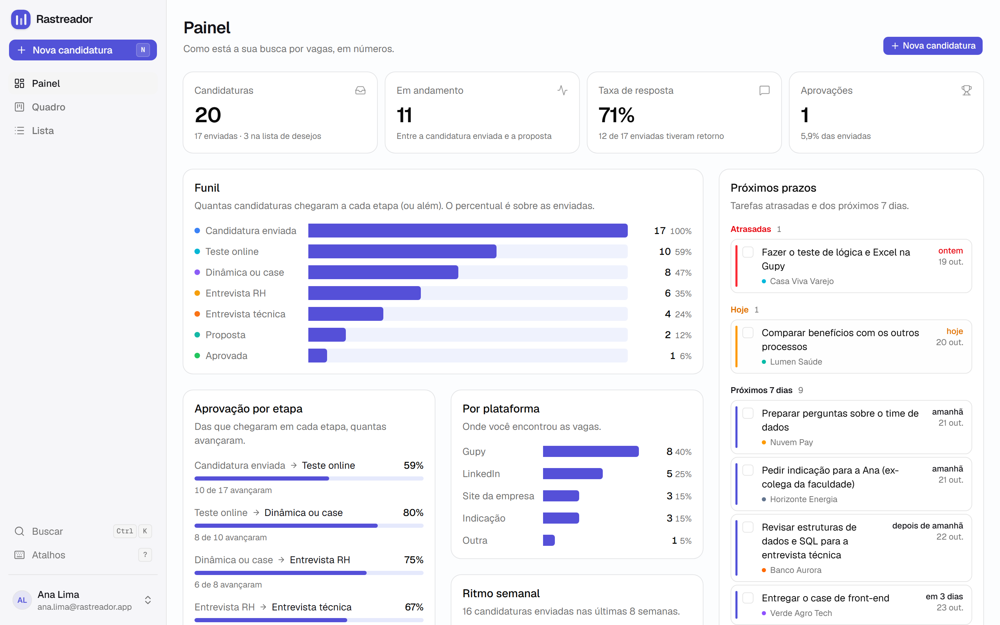
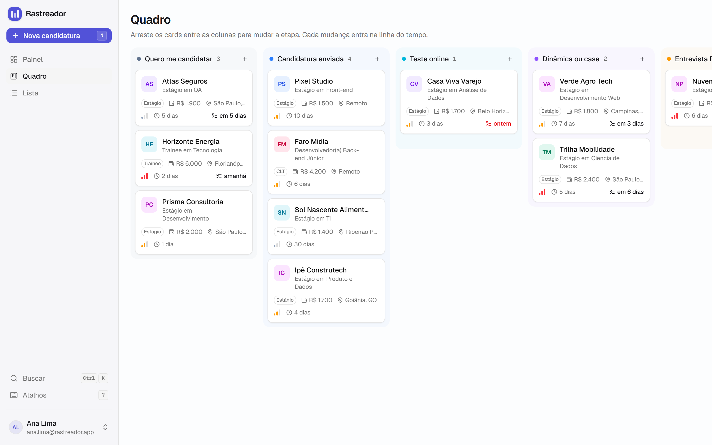
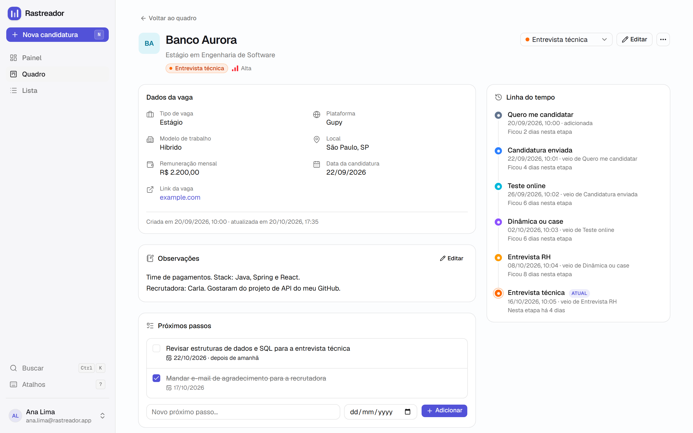
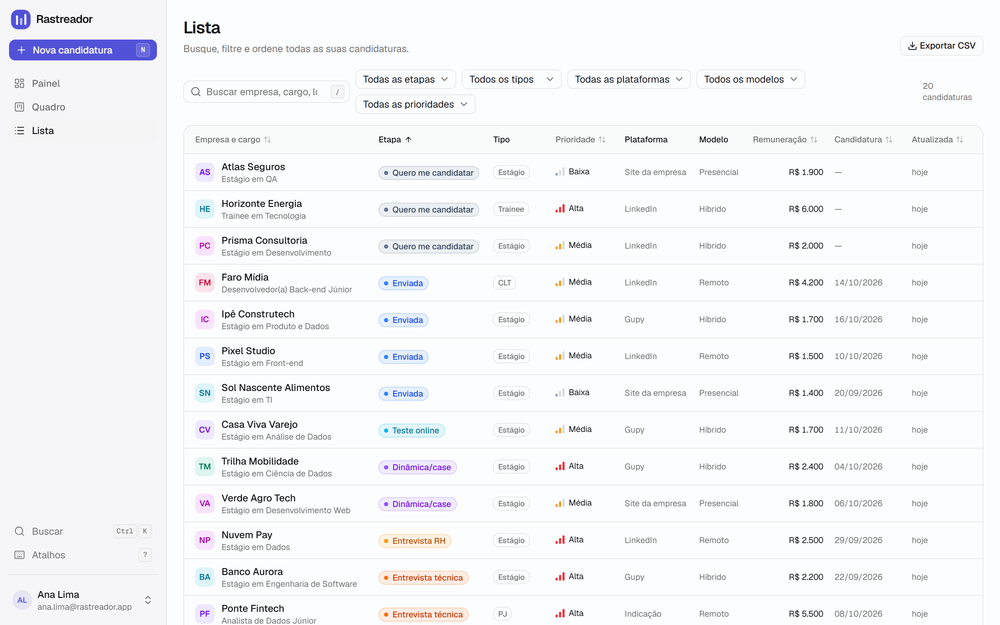
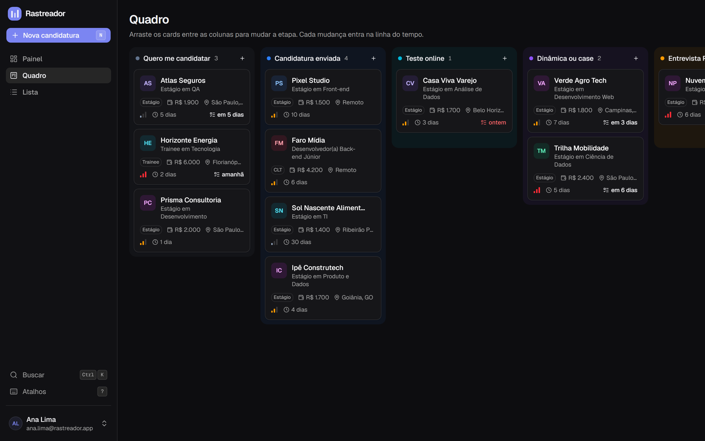
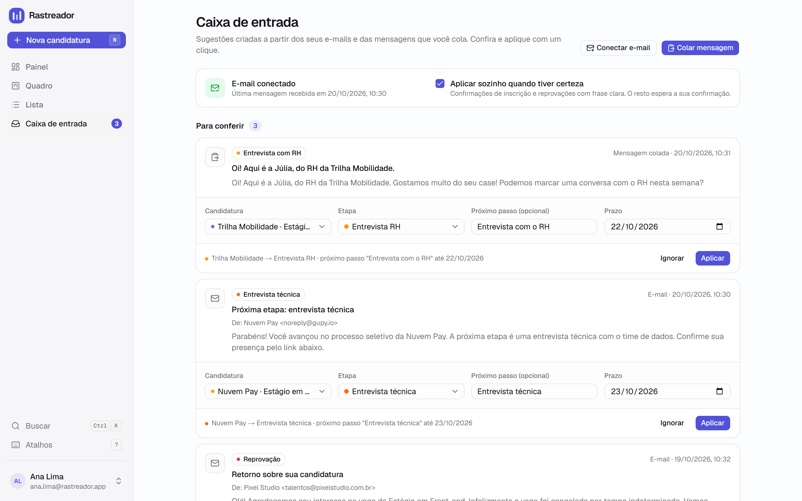
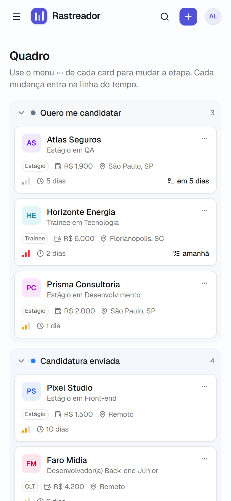
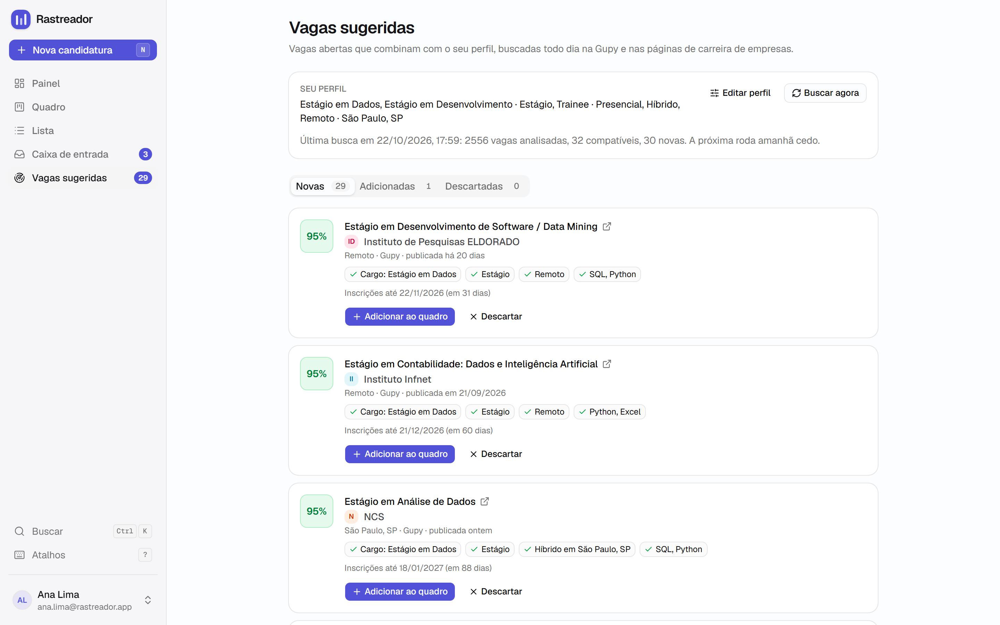

# Rastreador de candidaturas

Sistema web para acompanhar candidaturas a vagas (estágio, trainee, CLT, PJ, temporário ou freela),
do "quero me candidatar" até a proposta.
Tem quadro Kanban com arrastar e soltar, linha do tempo de cada vaga, próximos passos com prazo e um
painel com o funil e a taxa de resposta.

> **Demonstração:** [rastreador-de-candidaturas.vercel.app](https://rastreador-de-candidaturas.vercel.app). Clique em **Explorar a demonstração**: a conta já vem com dados de exemplo, e eles voltam ao original todo dia.
> _(troque o link pelo endereço do seu deploy)_



## Objetivo

Procurar estágio ou emprego vira uma planilha bagunçada rápido: vagas em várias plataformas, testes online com
prazo, entrevistas em etapas diferentes e nenhuma noção de onde o processo costuma travar. Este
projeto resolve isso para uso diário e, ao mesmo tempo, serve de vitrine técnica: CRUD completo com
back-end, banco relacional com regras de segurança por usuário, login, testes e deploy.

## Funcionalidades

- **Login e cadastro** com e-mail e senha, recuperação de senha e login com Google (opcional).
- **Quadro Kanban** com uma coluna por etapa. Arraste os cards entre colunas (ou use o teclado). A
  mudança é salva na hora, entra na linha do tempo e pode ser desfeita pelo aviso. As colunas finais
  (Aprovada, Reprovada, Desisti) podem ser recolhidas.
- **Tipo de vaga** (estágio, trainee, CLT, PJ, temporário, freela) e **remuneração** (bolsa ou
  salário), com etiqueta no card, filtro na lista e coluna no CSV.
- **Lista** com busca (ignora acentos), filtros por etapa, tipo de vaga, plataforma, modelo e prioridade, e
  ordenação por coluna. Os filtros ficam na URL, então dá para favoritar uma busca.
- **Página de detalhe** com todos os dados, observações, **linha do tempo** das etapas (com quanto
  tempo a vaga ficou em cada uma) e **próximos passos** com prazo.
- **Criar, editar, duplicar e excluir** (com confirmação).
- **Automação gratuita** pela **caixa de entrada**: os e-mails das plataformas e das empresas viram
  sugestões ("Nuvem Pay → Entrevista técnica, prazo 23/10"), e as inequívocas (confirmação de
  inscrição, reprovação clara) são aplicadas sozinhas. Também dá para **colar uma mensagem** do
  WhatsApp ou do LinkedIn, ou compartilhar direto pelo Android. Veja [Automação gratuita](#automação-gratuita).
- **Resumo diário por e-mail** (prazos, o que mudou, vagas paradas, números) e **assistente no
  WhatsApp** que responde "resumo", "prazos", "andamento" ou o nome de uma empresa, e transforma
  mensagens encaminhadas de recrutadores em sugestões. Tudo grátis.
- **Caça-vagas diário:** a pessoa diz o que procura (cargos, cidade, modelo, tipo de vaga,
  remuneração mínima, palavras-chave do currículo) e todo dia o app busca vagas abertas na Gupy e
  nas páginas de carreira de empresas (Greenhouse e Lever). Cada vaga ganha uma **nota de
  compatibilidade com os motivos** ("92%: Cargo: Estágio em Dados · Estágio · Híbrido em São Paulo
  · SQL, Python") e entra no quadro com um clique. Veja [Caça-vagas](#caça-vagas).
- **Painel** com total, em andamento, taxa de resposta, aprovações, funil, aprovação por etapa,
  candidaturas por plataforma, ritmo semanal e **próximos prazos** (atrasados, hoje e próximos 7 dias).
- **Exportar tudo em CSV**, pronto para abrir no Excel em português.
- **Dados de exemplo** com um clique e **conta de demonstração** que se restaura sozinha todo dia.
- **Atalhos de teclado:** `N` nova candidatura, `/` buscar, `Ctrl+K` paleta de comandos, `G` e
  depois `P`/`Q`/`L`/`C`/`V` para navegar, `?` mostra todos os atalhos.
- **Modo claro e escuro**, avisos leves (toast), estados vazios com ação e layout responsivo: no
  celular o Kanban vira uma lista agrupada por etapa.

| Quadro | Detalhe |
| --- | --- |
|  |  |
| **Lista** | **Modo escuro** |
|  |  |
| **Caixa de entrada** | **Celular** |
|  |  |
| **Vagas sugeridas** | |
|  | |

## Tecnologias

| Camada | Escolha |
| --- | --- |
| Framework | [Next.js 16](https://nextjs.org) (App Router, Server Components, Server Actions, Cache Components) com TypeScript |
| Interface | Tailwind CSS v4, [shadcn/ui](https://ui.shadcn.com) (Radix), lucide-react, Sonner (toasts), next-themes |
| Banco e login | [Supabase](https://supabase.com): PostgreSQL, Auth e Row Level Security, via `@supabase/ssr` |
| Formulários | React Hook Form + Zod (o mesmo schema valida no navegador e no servidor) |
| Arrastar e soltar | dnd-kit (mouse, toque e teclado, com anúncios para leitores de tela) |
| Gráficos | Recharts (pelos componentes de gráfico do shadcn) e barras em HTML/CSS |
| Testes | Vitest |
| Deploy | Vercel (com Cron diário para a conta demo) |

## Como funciona por dentro

### Modelo de dados

```
auth.users ──┬──< applications ──┬──< stage_history   (preenchida por trigger)
             │                   ├──< tasks
             │                   └──< inbox_items      (sugestões da caixa de entrada)
             ├──  user_settings                        (token do e-mail e automação)
             ├──  job_profiles                         (perfil do caça-vagas)
             ├──< job_leads                            (vagas sugeridas, com nota)
             └── (user_id em todas as tabelas, para o RLS)
```

- **applications**: empresa, cargo, tipo de vaga, link, plataforma, local, modelo, remuneração (em
  **centavos**, para não ter erro de arredondamento), data da candidatura, etapa, prioridade,
  observações e a posição do card na coluna.
- **stage_history**: cada mudança de etapa (de → para, com data e hora). Quem grava é um **trigger
  no PostgreSQL**, então nenhuma mudança escapa do histórico, venha do Kanban, do formulário ou de
  outro cliente.
- **tasks**: próximos passos com prazo opcional, ligados a uma candidatura.
- **inbox_items**: sugestões vindas de e-mails ou de mensagens coladas (tipo, etapa sugerida,
  empresa, cargo, prazo, trecho da mensagem e o que foi feito com ela).
- **user_settings**: hash do token pessoal do e-mail e a preferência de aplicar sozinho.
- **job_profiles**: o que a pessoa procura (cargos, tipos, modelos, cidade, palavras-chave, fontes)
  e o resumo da última busca.
- **job_leads**: vagas encontradas, com nota, motivos e situação (nova, adicionada ao quadro ou
  descartada). A mesma vaga nunca é sugerida duas vezes, nem depois de descartada.

As etapas são fixas e definidas em um só lugar ([src/lib/stages.ts](src/lib/stages.ts)): nome, cor,
ordem no funil e tipo. As mesmas chaves estão travadas no banco por restrições `CHECK`.

### Segurança

- **Row Level Security** ligado em todas as tabelas: cada usuário só lê e altera as próprias linhas
  (`(select auth.uid()) = user_id`). Tarefas e histórico ainda conferem se a candidatura ligada é
  do mesmo usuário.
- O servidor valida a sessão com `getClaims()` (confere a assinatura do token) e **toda Server
  Action revalida a entrada com Zod**, mesmo que o navegador já tenha validado.
- A chave secreta do Supabase só é usada no servidor (cron e script da conta demo) e nunca tem o
  prefixo `NEXT_PUBLIC_`.
- O CSV exportado neutraliza "injeção de fórmula" (`=`, `+`, `-`, `@` no início de um campo).
- Os e-mails entram por uma função do banco (`inbox_ingest`) que só aceita um **token pessoal**:
  o banco guarda apenas o hash (SHA-256) dele e grava só na conta dona do token. O Supabase avisa
  que essa função pode ser chamada sem login. Isso é intencional: quem chama é o script do Google,
  que não tem sessão, e sem um token válido a função recusa a chamada.

### Métricas

As métricas usam a **etapa mais avançada que cada vaga alcançou**, a partir do histórico. Uma vaga
reprovada depois da entrevista com RH continua contando como "chegou à entrevista com RH". E uma vaga
que pulou o teste online conta como tendo passado por ele.

- **Taxa de resposta:** das candidaturas enviadas, quantas tiveram retorno (avançaram ou foram reprovadas).
- **Aprovação por etapa:** das que chegaram a uma etapa, quantas chegaram à seguinte.

A lógica fica em [src/features/dashboard/metrics.ts](src/features/dashboard/metrics.ts) e tem testes.

### Ordem dos cards no Kanban

Cada card tem uma `position` decimal. Ao soltar um card entre dois outros, ele recebe a média das
posições vizinhas, então **só o card movido é salvo** no banco. A interface atualiza antes da
resposta do servidor e volta ao estado anterior se algo der errado.

### Estrutura de pastas

```
src/
  app/                      Rotas (App Router)
    (auth)/                 login, cadastro, recuperar e redefinir senha
    (app)/                  painel, quadro, lista, caixa-de-entrada, vagas, conexoes, candidaturas/[id], nova, editar
    api/export/             download do CSV
    api/cron/reset-demo/    restauração diária da conta demo
    api/cron/vagas/         busca diária de vagas para todos os perfis
    api/vagas/buscar/       busca de quem está logado (ao abrir o app e no botão "Buscar agora")
    api/inbox/email/        recebe os e-mails enviados pelo script do Google
    api/report/             resumo diário (chamado pelo script do Google)
    api/whatsapp/webhook/   assistente do WhatsApp (API oficial da Meta)
    auth/callback/          retorno dos e-mails e do Google
  features/                 Código organizado por funcionalidade
    applications/           schema (Zod), actions, queries, filtros, CSV, componentes
    board/                  lógica do Kanban (pura e testada) e componentes
    dashboard/              cálculo das métricas e gráficos
    tasks/                  próximos passos
    auth/                   sessão, actions e formulários de login
    demo/                   dados de exemplo e conta demo
    inbox/                  leitor de mensagens (regras), plano de cada sugestão, script do Google
    report/                 montagem do resumo diário (e-mail, WhatsApp e prévia)
    whatsapp/               assistente: comandos, vinculação por código, webhook
    job-search/             caça-vagas: fontes (Gupy, Greenhouse, Lever), nota de compatibilidade, busca
  components/               Componentes compartilhados (app-shell, ui do shadcn, etc.)
  lib/                      Supabase, etapas, opções, formatação pt-BR, CSV, erros
  types/database.ts         Tipos do banco
supabase/migrations/        SQL do banco (tabelas, trigger, RLS, índices)
scripts/seed-demo.ts        Cria/recria a conta demo
tests/                      Testes (Vitest)
```

## Configurar o Supabase

1. Crie uma conta em [supabase.com](https://supabase.com) e clique em **New project**. Escolha a
   região **South America (São Paulo)** e guarde a senha do banco.
2. **Crie as tabelas:** no menu lateral, abra **SQL Editor** → **New query**. Cole o conteúdo de
   cada arquivo da pasta [supabase/migrations](supabase/migrations) e clique em **Run**, um por vez
   e **nesta ordem**:
   1. `20261019000000_init.sql`
   2. `20261019000100_stage_history_immutable.sql`
   3. `20261020000000_job_type_and_salary.sql`
   4. `20261020010000_inbox.sql`
   5. `20261020010100_inbox_ingest_anon_only.sql`
   6. `20261021000000_report_and_whatsapp.sql`
   7. `20261022000000_job_search.sql`

   Confira em **Table Editor** se apareceram `applications`, `stage_history`, `tasks`,
   `inbox_items`, `user_settings`, `job_profiles` e `job_leads`, todas com o selo de RLS ativado.
   > Se você usa a CLI do Supabase: `npx supabase link --project-ref <id>` e `npx supabase db push`.
3. **Copie as chaves** para o `.env.local` (copie o [.env.example](.env.example) primeiro):

   | Variável | Onde encontrar no painel do Supabase |
   | --- | --- |
   | `NEXT_PUBLIC_SUPABASE_URL` | **Project Settings → Data API → Project URL** (ou o botão **Connect** no topo) |
   | `NEXT_PUBLIC_SUPABASE_PUBLISHABLE_KEY` | **Project Settings → API Keys → Publishable key** (começa com `sb_publishable_`) |
   | `SUPABASE_SECRET_KEY` | **Project Settings → API Keys → Secret keys** (começa com `sb_secret_`). Só é necessária para a conta demo, para o assistente do WhatsApp e para a busca diária de vagas pelo cron |

4. **Configure os endereços de retorno:** em **Authentication → URL Configuration**:
   - **Site URL:** `http://localhost:3000` (troque pelo endereço da Vercel depois do deploy).
   - **Redirect URLs:** adicione `http://localhost:3000/auth/callback` e, depois do deploy,
     `https://SEU-APP.vercel.app/auth/callback`.
5. **Confirmação de e-mail:** em **Authentication → Sign In / Providers → Email**, a opção
   **Confirm email** vem ligada. O servidor de e-mail gratuito do Supabase é só para testes: ele
   envia poucas mensagens por hora e apenas para e-mails da equipe do projeto. Escolha uma opção:
   - **Mais simples:** desligue **Confirm email**. A pessoa já entra logada depois do cadastro.
   - **Mais completo:** mantenha ligado e configure um SMTP próprio (por exemplo, [Resend](https://resend.com))
     em **Project Settings → Authentication → SMTP Settings**.

### Login com Google (opcional)

1. No [Google Cloud Console](https://console.cloud.google.com), crie um projeto e configure a
   **tela de consentimento OAuth** (tipo "Externo").
2. Em **APIs e serviços → Credenciais → Criar credenciais → ID do cliente OAuth**, escolha
   **Aplicativo da Web** e preencha:
   - **Origens JavaScript autorizadas:** `http://localhost:3000` e `https://SEU-APP.vercel.app`.
   - **URIs de redirecionamento autorizados:** a **Callback URL** que aparece no Supabase em
     **Authentication → Sign In / Providers → Google** (algo como `https://xxxx.supabase.co/auth/v1/callback`).
3. No Supabase, ative o provedor **Google** e cole o **Client ID** e o **Client Secret**.
4. No `.env.local` (e na Vercel), defina `NEXT_PUBLIC_GOOGLE_AUTH_ENABLED=true`. O botão "Continuar
   com Google" só aparece com essa variável ligada.

### Conta de demonstração

1. Preencha `SUPABASE_SECRET_KEY`, `DEMO_EMAIL` e `DEMO_PASSWORD` no `.env.local`.
   O e-mail não precisa existir (ex.: `demo@rastreador.app`): o script cria a conta pela API
   administrativa, já confirmada. Só a tela de cadastro comum exige um domínio que receba e-mails;
   o Supabase recusa até `@example.com` ali.
2. Rode `npm run seed:demo`. O script cria a conta (já confirmada) com 20 candidaturas de empresas
   fictícias, histórico e tarefas, e as datas ficam relativas ao dia em que ele roda.
3. A tela de login passa a mostrar **Explorar a demonstração**. A senha nunca vai para o navegador:
   o login da demo acontece no servidor.
4. Em produção, o Cron da Vercel chama `/api/cron/reset-demo` todo dia às 3h (horário de Brasília)
   e restaura dados e senha. Dentro da conta demo também há um botão **Restaurar agora**.

Qualquer outra conta pode carregar os mesmos dados de exemplo pelo botão **Carregar dados de
exemplo**, que aparece quando a conta está vazia.

## Automação gratuita

O app não enxerga o que você faz no navegador nem no celular. Ele recebe **sinais** de três
lugares, e todos viram sugestões na **Caixa de entrada**:

| De onde vem | Como chega | Configuração |
| --- | --- | --- |
| **E-mails** (Gupy, LinkedIn, sites de vagas, recrutadores) | Um script do Google Apps Script, rodando na **sua** conta Google, confere o Gmail a cada 10 minutos e envia só os e-mails de processos seletivos | Uma vez, cerca de 2 minutos |
| **Mensagens** (WhatsApp, LinkedIn, qualquer texto) | Botão **Colar mensagem** | Nenhuma |
| **Compartilhar no Android** | Com o app instalado no celular, ele aparece no menu **Compartilhar** | Instalar o app pelo navegador |

**O que o app entende** (regras em português, sem IA e sem custo, em
[src/features/inbox/parser.ts](src/features/inbox/parser.ts)):
- confirmação de inscrição, teste online, dinâmica ou case, entrevista com RH, entrevista técnica,
  proposta, aprovação e reprovação;
- empresa, cargo, plataforma e prazos ("até 25/10", "dia 3 de novembro", "amanhã");
- a **próxima** etapa, e não a que já passou ("seu case ficou ótimo, vamos marcar a entrevista");
- alertas de "novas vagas para você" são descartados.

**Automático ou com confirmação:** confirmações de inscrição e reprovações com frase clara são
aplicadas sozinhas quando o app abre (dá para desligar na Caixa de entrada). O resto aparece como
sugestão com uma prévia ("Nuvem Pay → Entrevista técnica · próximo passo até 23/10") e é aplicado
com um clique. A etapa **nunca anda para trás** (um e-mail atrasado não tira a vaga da entrevista)
e vagas já encerradas não mudam.

**Conectar o Gmail:** na Caixa de entrada, clique em **Conectar e-mail** e siga os passos. O app
gera um script com o seu token pessoal; você cola em [script.google.com](https://script.google.com),
roda a função `configurar` uma vez e autoriza. O script precisa do endereço publicado (Vercel),
porque o Google não alcança o `localhost` do seu computador.

**Custo zero para todo mundo:** cada pessoa conecta o próprio e-mail, e o script roda na conta
Google dela. Não há serviço pago no caminho. Um botão "Conectar com Google" de um clique exigiria
que o Google auditasse o app (processo pago) para ler o Gmail de outras pessoas. O script evita isso.

### Resumo diário por e-mail

O mesmo script do Google manda, todo dia no horário escolhido (padrão: 7h), um resumo para o Gmail
da própria pessoa: prazos atrasados, de hoje e da semana; o que mudou desde ontem; sugestões
esperando na caixa de entrada; vagas em andamento sem novidade há 14 dias ou mais; as **vagas
novas do caça-vagas**; e os números da semana. A prévia aparece na página **Conexões**. O envio usa a cota gratuita de e-mails da própria
conta Google, então não custa nada.

### Assistente no WhatsApp (opcional)

Pela API oficial da Meta. **Ele só responde quando a pessoa escreve**, e por isso é grátis: a Meta
não cobra até 1.000 respostas por mês por número (regra em vigor desde 1º/10/2026). Mensagens que a
empresa inicia, como um relatório enviado sozinho todo dia, são cobradas. Por isso o resumo
automático vai por e-mail e o WhatsApp funciona sob demanda.

O que a pessoa pode mandar: `resumo`, `prazos`, `andamento`, `sugestões`, `vagas`, o nome de uma empresa
("como está a Nuvem Pay?") ou uma **mensagem encaminhada de recrutador**, que vira sugestão na caixa
de entrada. Para conectar, ela gera um código em **Conexões** e manda `vincular CÓDIGO` para o
assistente, o que prova que o número é dela. Mandar `desvincular` desconecta.

**Como configurar** (quem publica o app faz uma vez):
1. Em [developers.facebook.com](https://developers.facebook.com), crie um app do tipo **Business** e
   adicione o produto **WhatsApp**. A Meta já oferece um **número de teste** grátis.
2. Em **WhatsApp → Configuração da API**, copie o **Phone number ID** e gere um token de acesso.
   O token temporário dura 24 horas; para um permanente, crie um **usuário do sistema** nas
   configurações do negócio com a permissão `whatsapp_business_messaging`. Para testar, adicione o
   seu número na lista de destinatários: o número de teste só conversa com até 5 números cadastrados.
3. Em **Configurações do app → Básico**, copie a **Chave secreta do app** (App Secret).
4. Em **WhatsApp → Configuração → Webhook**, use a URL `https://SEU-APP.vercel.app/api/whatsapp/webhook`,
   invente um **token de verificação** (o mesmo de `WHATSAPP_VERIFY_TOKEN`) e assine o campo
   **messages**.
5. Preencha na Vercel: `WHATSAPP_TOKEN`, `WHATSAPP_PHONE_NUMBER_ID`, `WHATSAPP_APP_SECRET`,
   `WHATSAPP_VERIFY_TOKEN`, `NEXT_PUBLIC_WHATSAPP_BOT_NUMBER` (o número do assistente, com DDI e DDD)
   e `SUPABASE_SECRET_KEY`. Faça um novo deploy.
6. Para qualquer pessoa usar (não só os 5 números de teste), cadastre um número de verdade, como um
   chip novo, no gerenciador do WhatsApp da Meta.

Sem `WHATSAPP_TOKEN` e `WHATSAPP_PHONE_NUMBER_ID`, o assistente fica em **modo de teste**: as
respostas aparecem no log e na resposta do webhook, sem envio pela Meta.

**WhatsApp pessoal:** não existe um meio oficial de um app ler as suas conversas, e as ferramentas
não oficiais podem banir o número. Por isso as mensagens de recrutadores entram pelo **Colar
mensagem**, pelo **Compartilhar** do Android ou **encaminhadas para o assistente**.

## Caça-vagas

Na página **Vagas sugeridas**, a pessoa monta um perfil de busca uma vez: cargos (até 5), tipos de
vaga, modelos de trabalho, cidade e estado, remuneração mínima, palavras-chave do currículo,
palavras para evitar e as fontes. A partir daí o app busca vagas todo dia e mostra as mais
compatíveis.

**Fontes** (todas públicas, sem login e sem custo):

| Fonte | Como o app lê | Observação |
| --- | --- | --- |
| **Gupy** | A mesma busca pública que o portal de vagas da Gupy usa no navegador, por cargo, tipo de vaga, estado e vagas remotas | Não é uma API oficial: se a Gupy mudar o formato, a busca registra o erro e as outras fontes seguem funcionando |
| **Greenhouse** | Job Board API, a listagem pública oficial de cada empresa | Não tem busca geral, por isso existe uma lista pronta de 16 empresas com vagas no Brasil (QuintoAndar, Stone, C6 Bank, Inter, XP, BTG, VTEX, EBANX, Wellhub e outras) |
| **Lever** | Postings API, também oficial e pública | Lista pronta com CI&T, Neon, Swile e dLocal |

A pessoa pode acrescentar outras empresas colando o link da página de vagas
(`boards.greenhouse.io/...` ou `jobs.lever.co/...`). A lista pronta fica em
[src/features/job-search/boards.ts](src/features/job-search/boards.ts). LinkedIn e Indeed ficam de
fora: não têm listagem pública e proíbem a coleta automática.

**Nota de compatibilidade** (regras em [src/features/job-search/score.ts](src/features/job-search/score.ts),
sem IA): cargo 45 pontos, tipo de vaga 20, local e modelo 20, palavras-chave do currículo 15. O
cargo é comparado sem acentos e com sinônimos em português e inglês ("Dados" = "Data",
"Desenvolvedor" = "Developer"). Cada ponto vira um motivo na tela. Ficam de fora, em vez de ganhar
nota baixa: outro tipo de vaga, nível sênior ou de liderança (quando o cargo do perfil não pede),
outra cidade em vaga presencial ou híbrida, vaga fora do Brasil, inscrições encerradas, banco de
talentos, jovem aprendiz e títulos com palavras a evitar. Remuneração abaixo do mínimo vira aviso e
desconta pontos. Só entram vagas com nota a partir de 60, no máximo 30 novas por busca.

**Quando roda:**
- **Todo dia cedo**, pelo Cron da Vercel (`/api/cron/vagas`, às 5h de Brasília), para todos os
  perfis com busca automática. Os downloads das páginas das empresas são reaproveitados entre os
  perfis. Precisa da `SUPABASE_SECRET_KEY`.
- **Ao abrir o app**, se a última busca foi há mais de 20 horas. Assim funciona mesmo sem o cron.
- **No botão "Buscar agora"**, no máximo uma vez a cada 2 minutos.

As vagas novas aparecem no menu (com o número), na página **Vagas sugeridas**, no **resumo diário
por e-mail** e no comando `vagas` do assistente do WhatsApp. **Adicionar ao quadro** cria a
candidatura em "Quero me candidatar" com empresa, cargo, link, local, modelo, tipo e a nota.
**Descartar** tira a vaga da lista para sempre (com desfazer).

## Rodar localmente

Requisitos: Node.js 20.9 ou mais novo e um projeto no Supabase (seção acima).

```bash
npm install
cp .env.example .env.local   # e preencha as chaves
npm run dev                  # http://localhost:3000
```

| Comando | O que faz |
| --- | --- |
| `npm run dev` | Servidor de desenvolvimento |
| `npm run build` / `npm start` | Build e servidor de produção |
| `npm test` | Roda os testes (Vitest) |
| `npm run lint` | ESLint |
| `npm run typecheck` | Checagem de tipos do TypeScript |
| `npm run seed:demo` | Cria ou recria a conta de demonstração |

### Testes

Os testes cobrem as partes que mais importam:

- **Criação:** validação do formulário (mensagens em português, link, valor em reais, datas, tipo de vaga) e a
  Server Action `createApplication` (grava para o usuário certo, não toca no banco com dados
  inválidos, traduz erros do banco).
- **Mudança de etapa:** a Server Action `moveApplication` (filtra pelo dono, recusa etapa inválida,
  posição padrão no topo), a edição pelo formulário e a lógica do Kanban (mover, reordenar, desfazer).
- **Métricas:** etapa mais avançada, funil, taxa de resposta, aprovação por etapa, plataformas e
  ritmo semanal, incluindo os casos sem dados.
- **Resumo diário e WhatsApp:** prazos, novidades, vagas paradas e números do resumo; o e-mail
  escapa o texto do usuário; os comandos do assistente, a vinculação por código, a empresa
  citada, a mensagem encaminhada que vira sugestão, mensagens repetidas ignoradas, a assinatura da
  Meta e as rotas `/api/report` e `/api/whatsapp/webhook`.
- **Caça-vagas:** a leitura de cada fonte no formato real (Gupy, Greenhouse e Lever), nomes de
  empresas, estados e cidades, tipo e nível pelo título ("Internal Audit" não é estágio), a nota e
  cada motivo para deixar uma vaga de fora, a busca com fonte fora do ar, o reaproveitamento dos
  downloads no cron, vagas já sugeridas ou já no quadro, o perfil e a candidatura criada a partir da
  vaga.
- **Automação:** o leitor de mensagens (confirmação da Gupy e do LinkedIn, reprovação, teste,
  entrevistas, case, proposta, aprovação, mensagem colada do WhatsApp, alertas de vagas ignorados,
  datas), a escolha da candidatura e da etapa (nunca para trás) e a rota que recebe os e-mails.
- Formatação brasileira (datas, fuso de São Paulo, reais), CSV, filtros da lista e dados de exemplo.

## Deploy na Vercel

1. Suba o projeto para um repositório no GitHub.
2. Em [vercel.com](https://vercel.com), clique em **Add New → Project** e importe o repositório. A
   Vercel detecta o Next.js sozinha, então não precisa mudar nada no build.
3. Em **Environment Variables**, adicione as mesmas variáveis do `.env.local`:
   - `NEXT_PUBLIC_SUPABASE_URL`, `NEXT_PUBLIC_SUPABASE_PUBLISHABLE_KEY` (obrigatórias)
   - `NEXT_PUBLIC_SITE_URL` = `https://SEU-APP.vercel.app`
   - `SUPABASE_SECRET_KEY` (conta demo, assistente do WhatsApp e busca diária de vagas)
   - `DEMO_EMAIL`, `DEMO_PASSWORD` (conta demo)
   - `CRON_SECRET`: um valor aleatório longo (por exemplo, gerado com `openssl rand -hex 32`)
   - `NEXT_PUBLIC_GOOGLE_AUTH_ENABLED=true` (se configurou o Google)
   - As variáveis `WHATSAPP_*` e `NEXT_PUBLIC_WHATSAPP_BOT_NUMBER` (se for usar o assistente do WhatsApp)
4. Clique em **Deploy**.
5. Com o endereço final em mãos, volte ao Supabase (**Authentication → URL Configuration**) e
   coloque-o como **Site URL**, com `https://SEU-APP.vercel.app/auth/callback` nas **Redirect
   URLs**. Se usa Google, adicione o domínio também nas origens autorizadas do Google Cloud.
6. O arquivo [vercel.json](vercel.json) já agenda os dois crons diários: a restauração da conta
   demo e a busca de vagas. Como o `CRON_SECRET` está definido, a Vercel envia esse valor no
   cabeçalho e as rotas aceitam a chamada. O plano grátis da Vercel permite crons uma vez por dia.

> Variáveis `NEXT_PUBLIC_` são embutidas no build. Se mudar alguma depois, faça um novo deploy
> (**Deployments → ⋯ → Redeploy**).

## Decisões e próximos passos

- **Etapas fixas** em vez de personalizáveis: deixam o funil e as métricas bem definidos. Para
  permitir etapas próprias, o caminho seria uma tabela `stages` por usuário com uma "categoria" que
  as métricas continuariam usando.
- **Cache Components (Next.js 16):** a moldura das páginas (menu, títulos) é pré-renderizada e
  aparece na hora; os dados do usuário chegam por streaming, com esqueletos no lugar.
- Ideias para o futuro: lembretes por e-mail dos prazos, anexos (currículo enviado para cada vaga),
  contatos de recrutadores e importação de vagas por link.
